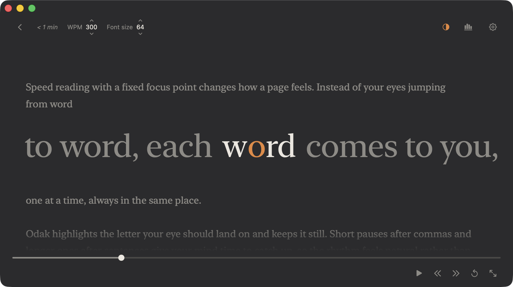
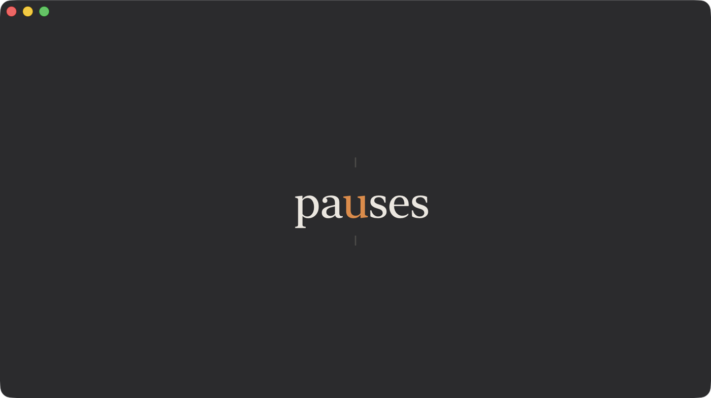

# Odak

**A free, open-source speed reader for macOS** — plus a browser extension that works on any OS.

Odak shows text one word at a time at a fixed focus point (RSVP), so your eyes stay still while you read. Pause at any moment and the surrounding text appears; press Space and the page fades away, leaving only the word.

[English](#english) · [Türkçe](#türkçe)

| Paused: the full text around the current word | Reading: only the word |
| --- | --- |
|  |  |

---

## English

### Features

- **Read anything:** paste or type text, drop a file, or open **TXT, Markdown, PDF, RTF/RTFD, Word (.docx/.doc), HTML and ODT**.
- **Fixed focus point:** the letter your eye should land on is highlighted and never moves.
- **Calm reading screen:** the text opens paused, with the surrounding text visible. Click or press Space to start; the text and toolbars fade out and come back when you pause or move the mouse.
- **Natural pacing:** longer pauses after sentences, commas and paragraphs, extra time for long words, and a **slow start** that eases into your speed.
- **Resume where you left off:** reopen the same text and Odak continues from the last word; a *Continue reading* card waits on the start screen.
- **Reading statistics (⌘Y):** words today and this week, total time, average speed, your daily streak and a 14-day chart.
- **Soft themes:** Charcoal, Midnight, Sepia and Paper.
- **Read with Odak** from any app: select text, right-click › Services.
- **English and Turkish** interface, VoiceOver labels.
- **Private:** no network access, no accounts, no tracking. Native SwiftUI, no third-party dependencies.

### Install

Requires macOS 14 (Sonoma) or later. Pick one:

**1. Download** — get `Odak.zip` from the [latest release](../../releases/latest), unzip it and move **Odak.app** to Applications. The app is signed and notarized by Apple, so it opens with a single click.

**2. Ask your AI coding assistant** — give this repository to Claude Code, Codex, Cursor or a similar tool and say *"install this app on my Mac"*. The instructions it needs are in [AGENTS.md](AGENTS.md).

**3. Build it yourself** — needs Swift 6 (Xcode 16 or Apple's Command Line Tools; the script offers to install them if they are missing):

```bash
git clone https://github.com/halil-balci/odak.git
cd odak
scripts/install.sh
```

`scripts/install.sh` builds the app, copies it to `/Applications` (or `~/Applications`), registers the *Read with Odak* service and opens Odak. Run it again to update.

### Use

1. Paste or type text and press **Read** (⌘↩), choose **Paste & Read** (⇧⌘V), **Open File…** (⌘O), or drop a file on the window or the Dock icon.
2. The reader opens paused. Click the text or press **Space** to start, and again to pause.
3. Press **Esc** to go back to the text.

The top toolbar shows the time left and lets you change the speed, the font size and the theme. The bottom toolbar has the progress bar (click or drag to jump) and the playback buttons.

#### Keyboard shortcuts

| Key | Action |
| --- | --- |
| Space | Play / pause |
| ← / → | Previous / next word |
| Scroll | Move through the words (pauses reading) |
| ⌥← / ⌥→ | Previous / next sentence |
| ↑ / ↓ | Speed ±25 WPM |
| R | Restart from the beginning |
| Esc | Back to the text |
| ⌘↩ | Read the text in the editor |
| ⇧⌘V | Paste & Read |
| ⌘O | Open a file |
| ⌘Y | Reading statistics |
| ⌘, | Settings (speed, font, theme, focus-letter highlight, slow start) |

#### Read with Odak from any app

Select text in any app, then right-click › **Services** › **Read with Odak**.
If it is not listed, open **System Settings › Keyboard › Keyboard Shortcuts… › Services › Text** and enable **Read with Odak** (you can give it a shortcut there too). If it still doesn't show up, run `/System/Library/CoreServices/pbs -update` and reopen the app you are reading from.

**Keyboard shortcut:** in the same place (**System Settings › Keyboard › Keyboard Shortcuts… › Services › Text**), double-click *none* next to **Read with Odak** and press a combination, for example **⌃⌥⌘O**. Then select text in any app and press it. Three modifiers keep it clear of apps' own shortcuts; macOS shows a warning triangle if it collides with another one. AI assistants can set it for you (see [AGENTS.md](AGENTS.md)), or run:

```bash
defaults write pbs NSServicesStatus -dict-add "com.halilbalci.odak - Read with Odak - readSelection" '{ key_equivalent = "@~^o"; }'
/System/Library/CoreServices/pbs -update
```

This changes only Odak's shortcut. Apps that draw their own right-click menu (Claude, VS Code, Slack and other Electron apps) don't show Services there, but the shortcut and the app menu › Services usually still work.

### Browser extension (Chrome, Edge, Brave — any OS)

The extension in [`chrome-extension/`](chrome-extension) is a complete speed reader on its own: no Mac app needed, works on macOS, Windows and Linux.

**Install**

1. Open `chrome://extensions` (Edge: `edge://extensions`) and turn on **Developer mode**.
2. Click **Load unpacked** and choose this repository's `chrome-extension` folder. Keep the folder where it is; the browser loads the extension from there.
3. Pin the Odak icon from the extensions (puzzle) menu.

**Use:** select text and right-click › **Read with Odak**, or click the toolbar icon to read the whole page. The reader works like the app: it opens paused, uses the same shortcuts and themes, eases into your speed and remembers where you stopped. Esc closes the window.

Browsers don't let extensions read their own pages (`chrome://`, the Web Store) or the built-in PDF viewer; there, select the text and use the right-click menu.

### Privacy

Odak makes no network requests. Your texts never leave your computer.
The app stores its settings, your statistics and your last reading position on your Mac only. The extension stores only your settings and reading positions in the browser (`chrome.storage.local`).

### Development

```bash
swift build && swift test
node --test chrome-extension/tests/*.test.mjs
scripts/build-app.sh && open build/Odak.app
```

Services, localization and file associations only work from the app bundle, not from `swift run`. See [CONTRIBUTING.md](CONTRIBUTING.md) for the project layout and rules.

**Releases (maintainers):** `scripts/build-app.sh --release` signs the app with a Developer ID, notarizes it with Apple and staples the ticket, producing `build/Odak.zip`. It needs a *Developer ID Application* certificate in the keychain and a `notarytool` keychain profile (default name `odak-notary`).

### Roadmap

- EPUB support
- A global shortcut to read the current selection

### Contributing

Bug reports and pull requests are welcome; see [CONTRIBUTING.md](CONTRIBUTING.md).

### License

[MIT](LICENSE) © 2026 Odak contributors

---

## Türkçe

**Odak**, macOS için ücretsiz ve açık kaynaklı bir hızlı okuma uygulamasıdır; her işletim sisteminde çalışan bir tarayıcı eklentisi de vardır.

Metni sabit bir odak noktasında kelime kelime gösterir; gözünüz hareket etmeden okursunuz. Duraklattığınızda çevredeki metin görünür, Boşluk'a bastığınızda sayfa kaybolur ve yalnızca kelime kalır.

### Özellikler

- **Her şeyi okuyun:** metni yapıştırın, yazın, dosya sürükleyin ya da **TXT, Markdown, PDF, RTF/RTFD, Word (.docx/.doc), HTML ve ODT** dosyası açın.
- **Sabit odak noktası:** gözünüzün ineceği harf vurgulanır ve hiç yer değiştirmez.
- **Sakin okuma ekranı:** metin duraklatılmış açılır ve çevresi görünür. Başlamak için tıklayın veya Boşluk'a basın; metin ve araç çubukları kaybolur, duraklattığınızda ya da fareyi oynattığınızda geri gelir.
- **Doğal tempo:** cümle, virgül ve paragraf sonlarında daha uzun duraklama, uzun kelimelere ek süre ve hızınıza yavaşça çıkan **yavaş başlangıç**.
- **Kaldığınız yerden devam:** aynı metni yeniden açtığınızda Odak son kelimeden devam eder; başlangıç ekranında *Okumaya devam et* kartı sizi bekler.
- **Okuma istatistikleri (⌘Y):** bugün ve bu hafta okunan kelime, toplam süre, ortalama hız, üst üste okunan gün serisi ve 14 günlük grafik.
- **Yumuşak temalar:** Charcoal, Midnight, Sepia ve Paper.
- **Her uygulamadan Odak ile oku:** metni seçin, sağ tıklayın › Servisler.
- **Türkçe ve İngilizce** arayüz, VoiceOver desteği.
- **Gizlilik:** internet bağlantısı, hesap ya da izleme yok. Yerel SwiftUI, üçüncü taraf bağımlılık yok.

### Kurulum

macOS 14 (Sonoma) veya üstü gerekir. Birini seçin:

**1. İndirin:** [son sürümden](../../releases/latest) `Odak.zip` dosyasını indirin, açın ve **Odak.app**'i Uygulamalar klasörüne taşıyın. Uygulama Apple tarafından imzalı ve onaylı (notarize) olduğu için tek tıkla açılır.

**2. Yapay zekâ asistanınıza kurdurun:** bu depoyu Claude Code, Codex, Cursor gibi bir araca verin ve *"bu uygulamayı Mac'ime kur"* deyin. Gereken talimatlar [AGENTS.md](AGENTS.md) dosyasında.

**3. Kendiniz derleyin:** Swift 6 gerekir (Xcode 16 ya da Apple'ın Command Line Tools paketi; eksikse script kurmayı önerir):

```bash
git clone https://github.com/halil-balci/odak.git
cd odak
scripts/install.sh
```

Script uygulamayı derler, `/Applications` (ya da `~/Applications`) klasörüne kopyalar, *Odak ile oku* hizmetini kaydeder ve Odak'ı açar. Güncellemek için yeniden çalıştırın.

### Kullanım

1. Metni yapıştırıp **Oku**'ya basın (⌘↩), **Yapıştır ve Oku** (⇧⌘V) ya da **Dosya Aç…** (⌘O) seçin veya dosyayı pencereye ya da Dock simgesine bırakın.
2. Okuyucu duraklatılmış açılır. Başlamak için metne tıklayın ya da **Boşluk**'a basın; duraklatmak için tekrar basın.
3. Metne dönmek için **Esc**'ye basın.

Üst çubuk kalan süreyi gösterir; hızı, yazı boyutunu ve temayı buradan değiştirirsiniz. Alt çubukta ilerleme çubuğu (tıklayarak ya da sürükleyerek atlayın) ve oynatma düğmeleri vardır.

**Kısayollar:** Boşluk oynat/duraklat · ←/→ kelime · kaydırma kelimeler arasında gezinir (okumayı duraklatır) · ⌥←/⌥→ cümle · ↑/↓ hız ±25 · R baştan · Esc metne dön · ⌘↩ oku · ⇧⌘V yapıştır ve oku · ⌘O dosya aç · ⌘Y istatistikler · ⌘, ayarlar.

**Her uygulamadan okuma:** metni seçip sağ tıklayın › **Servisler** › **Odak ile oku**. Listede yoksa **Sistem Ayarları › Klavye › Klavye Kısayolları… › Servisler › Metin** bölümünden **Odak ile oku**'yu açın.

**Klavye kısayolu:** aynı yerde **Odak ile oku**'nun yanındaki *yok* yazısına çift tıklayıp bir kombinasyona basın, örneğin **⌃⌥⌘O**. Sonra herhangi bir uygulamada metni seçip kısayola basın. Üç değiştirici tuş, uygulamaların kendi kısayollarıyla çakışmayı önler; çakışma varsa macOS uyarı üçgeni gösterir. Yapay zekâ asistanları bunu sizin için ayarlayabilir ([AGENTS.md](AGENTS.md)) ya da şu komutu çalıştırın (yalnızca Odak'ın kısayolunu değiştirir):

```bash
defaults write pbs NSServicesStatus -dict-add "com.halilbalci.odak - Read with Odak - readSelection" '{ key_equivalent = "@~^o"; }'
/System/Library/CoreServices/pbs -update
```

Kendi sağ tık menüsünü çizen uygulamalar (Claude, VS Code, Slack gibi Electron uygulamaları) orada Servisler'i göstermez; kısayol ve uygulama menüsü › Servisler genellikle yine çalışır.

### Tarayıcı eklentisi (Chrome, Edge, Brave; her işletim sistemi)

[`chrome-extension/`](chrome-extension) klasöründeki eklenti, Mac uygulaması olmadan da çalışan tam bir hızlı okuyucudur.

1. `chrome://extensions` (Edge: `edge://extensions`) sayfasını açıp **Geliştirici modu**'nu açın.
2. **Paketlenmemiş öğe yükle**'ye tıklayıp bu deponun `chrome-extension` klasörünü seçin. Klasörü yerinden taşımayın.
3. Odak simgesini uzantılar (yapboz) menüsünden araç çubuğuna sabitleyin.

Seçili metne sağ tıklayıp **Odak ile oku**'yu seçin ya da sayfanın tamamını okumak için simgeye tıklayın. Okuyucu uygulama gibi çalışır: duraklatılmış açılır, aynı kısayolları ve temaları kullanır, kaldığınız yeri hatırlar. Esc pencereyi kapatır.

### Gizlilik

Odak hiçbir ağ isteği yapmaz; metinleriniz bilgisayarınızdan çıkmaz. Ayarlar, istatistikler ve son okuma konumu yalnızca sizin cihazınızda saklanır.

### Lisans

[MIT](LICENSE) © 2026 Odak contributors
